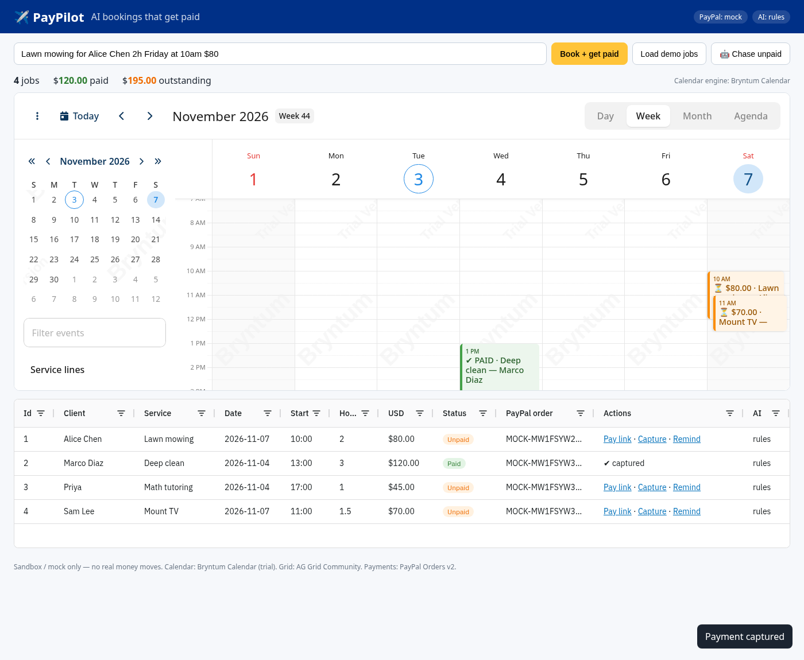

# ✈️ PayPilot — AI bookings that get paid

**Type a job in plain English. PayPilot's AI agent schedules it, sends a PayPal pay link, tracks who has paid, and chases whoever hasn't.**

> "Lawn mowing for Alice Chen 2h Friday at 10am $80"
> → a 2-hour slot on Friday in a **Bryntum Calendar**, a **PayPal Orders v2** order with a pay link, a row on an **AG Grid** paid/unpaid board, and an AI-drafted reminder if Alice hasn't paid yet.

Built for the **PayPal AI Hackathon 2026** for freelancers and small service businesses (lawn care, cleaners, tutors, handymen) who still run their week on texts, paper and "did you Venmo me?".

## 🔴 Live demo: https://barood-labs.github.io/paypilot/

Free hosted demo in **mock mode**: no PayPal keys and no secrets. It uses the rule-based parser. Click **Load demo jobs**, open a **Pay link**, approve the mock checkout and watch the job turn green, then hit **Chase unpaid**. The demo is static (GitHub Pages). The same parser and booking/capture logic run in your browser and your data stays in localStorage. Add `?reset` to the URL to start over. For the full server (real PayPal sandbox + LLM), run it locally or use the included `Dockerfile` (listens on port 7860, ready for Hugging Face Docker Spaces).
Rebuild/deploy: `node scripts/build-static.mjs`, push `dist/` to the `gh-pages` branch. Check it with `node scripts/smoke-hosted.mjs <url>`.



## What it does

| Step | What happens | Tech |
|---|---|---|
| 1. Ask | Owner types or pastes a job request in natural language | — |
| 2. Understand | AI extracts service, client, price, duration, date, start time and service line. The output is validated, and a deterministic rule parser takes over if the model is offline or returns junk | LLM (any OpenAI-compatible API) + rule fallback |
| 3. Schedule | The job appears on a week/day/month/agenda calendar, color-coded by paid status and grouped by service line. **Drag or resize to reschedule**, and the server updates | **Bryntum Calendar** |
| 4. Get paid | A PayPal order (`intent: CAPTURE`) is created and the approval link is attached to the booking. After the buyer approves, PayPal redirects to `/paypal/return` and the server **captures** the payment | **PayPal Orders v2** (sandbox) |
| 5. Track | A sortable, filterable board shows every job, its PayPal order id and Paid/Unpaid status. Totals show paid vs. outstanding | **AG Grid** Community |
| 6. Chase | "🤖 Chase unpaid" runs an agent sweep that drafts a polite reminder with the exact pay link for every unpaid job | LLM + template fallback |

## Quick start (mock mode, no keys needed)

```bash
npm install          # also installs the Bryntum Calendar trial from npm (@bryntum/calendar-trial)
npm test             # 9 unit + end-to-end tests (mock PayPal and a fake PayPal sandbox API)
npm start            # http://localhost:3000, then click "Load demo jobs"
npm run smoke        # optional: headless Chrome render check + docs/screenshot.png
```

In mock mode the pay link opens a local "Mock PayPal checkout" page so you can try the whole approve → capture loop offline.

### Real PayPal sandbox + AI

1. Create a free app at <https://developer.paypal.com> (Apps & Credentials → Sandbox).
2. Put the keys in a file **outside the repo** (see `.env.example`):
   ```bash
   ENV_FILE=~/paypal_sandbox.env npm start
   ```
   - `PAYPAL_CLIENT_ID`, `PAYPAL_CLIENT_SECRET` switch on sandbox Orders v2.
   - `OPENAI_API_KEY` (plus optional `OPENAI_BASE_URL` / `OPENAI_MODEL`) switches on the LLM parser and reminder agent.
     Runs fully local too: with [Ollama](https://ollama.com) use `OPENAI_API_KEY=ollama OPENAI_BASE_URL=http://localhost:11434/v1 OPENAI_MODEL=qwen2.5:3b`. The model extracts the fields and the day phrase ("next thursday"); PayPilot's deterministic resolver does the calendar math, so even a 3B model books the right date.
3. Book a job, open the pay link, and log in with a sandbox **personal** account. You'll come back to PayPilot with the payment captured and the row turned green.

The header badges show the active modes (`PayPal: mock|sandbox`, `AI: rules|llm`). No live PayPal endpoint is used unless you explicitly set `PAYPAL_API_BASE`.

## Architecture

```
public/            index.html + app.js (UI), calendar-adapter.js, mock-pay.html
  calendar-adapter.js  Bryntum Calendar (primary) → FullCalendar fallback, one interface:
                       createCalendar(el,{onMove}) → { kind, setBookings(list) }
server.js          Express API
  POST /api/book                 AI parse → PayPal order → store
  GET  /api/bookings|summary     data for calendar + grid
  PATCH /api/bookings/:id        drag/resize from Bryntum → reschedule
  POST /api/bookings/:id/capture capture a PayPal order
  POST /api/bookings/:id/remind  AI reminder for one job
  POST /api/agent/chase          agent sweep over all unpaid jobs
  GET  /paypal/return            PayPal return_url → server-side capture
lib/parse.js       LLM extraction + validation + rule-based fallback (dates, times, minutes, categories)
lib/paypal.js      OAuth token cache, Orders v2 create (PayPal-Request-Id, return/cancel URLs) + capture, mock mode
lib/agent.js       reminder drafting (LLM, guaranteed to include the pay link, or template)
test/              node:test unit + HTTP end-to-end (mock and fake-sandbox)
```

Bryntum assets are served from `node_modules/@bryntum/calendar-trial` at `/vendor/bryntum` and aren't checked into this repo. Add `?calendar=fullcalendar` to the URL to force the fallback engine.

## Sponsor tech used (prize tracks)

- **PayPal**: Orders v2 create + capture, return-URL flow, idempotency header. This is the core of the "agentic commerce" loop: an AI agent turns a sentence into a payable order and follows up until it's paid. *(Best Use of Agentic Commerce)*
- **Bryntum Calendar**: the scheduling surface. It has multi-view (day/week/month/agenda), a service-line resource filter, paid/unpaid coloring, and drag-and-drop rescheduling that syncs to the API. *(Best Use of Bryntum)*
- **AG Grid Community**: the paid/unpaid ledger with custom cell renderers, sorting, filtering and inline actions (pay link, capture, remind). *(Best Use of AG Grid)*
- **AI**: natural-language job extraction plus an agent that drafts payment reminders. It works with any OpenAI-compatible model, with safe fallbacks.

## Safety

- Sandbox or mock only. No real money moves in this project.
- Secrets are never committed (`.env*` is git-ignored, and `ENV_FILE` lets keys live outside the repo).
- LLM output is validated (amount, hours, date, time, category) before it reaches PayPal.
- User text is HTML-escaped in the UI.

## Roadmap

PayPal Invoicing v2 for repeat clients, webhooks (`CHECKOUT.ORDER.APPROVED` / `PAYMENT.CAPTURE.COMPLETED`), SMS/email delivery of reminders, persistent storage, and multi-crew scheduling with Bryntum resource views.

## License

MIT (this repository). Bryntum Calendar is a commercial product used here under its free trial from npm. AG Grid Community is MIT.
